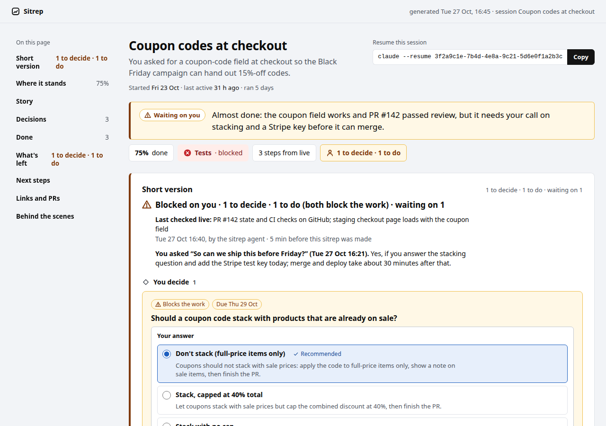
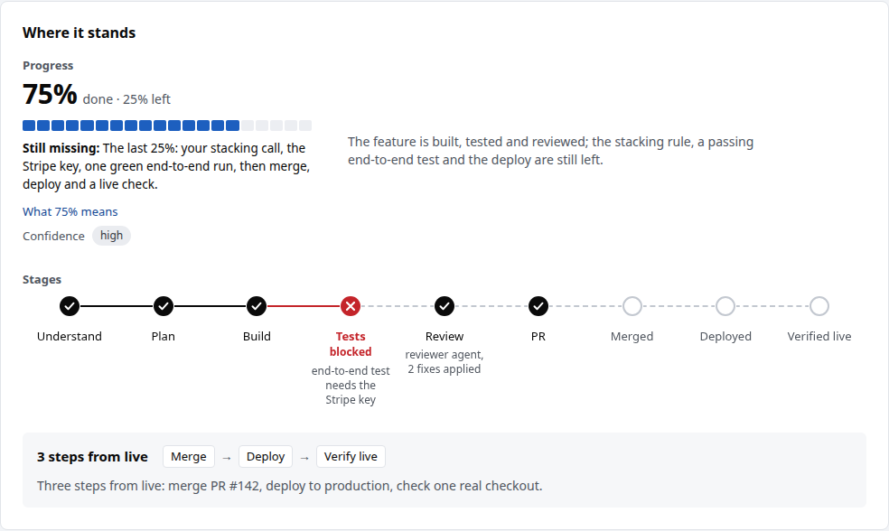
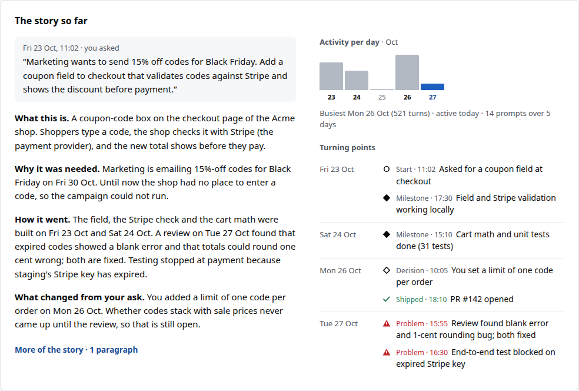
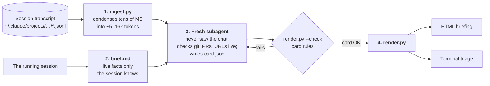

<div align="center">

# 🧭 /sitrep

**Forgot what that Claude Code session was about? Type `/sitrep`.**<br>
You get a one-page briefing written for someone coming back cold: what the task is, why it exists, what's done, what's left, how far it is from live, and what it needs from you.

[](LICENSE)
[](https://docs.claude.com/en/docs/claude-code/skills)
[](#requirements)
[](#requirements)



</div>

---

## Why

If you run several Claude Code sessions at once, and each one spans a few days, you lose track. You come back to a terminal tab and see a status line like *"G3 done, waiting on Acme for the tag, PR up"*, and you can't remember what G3 is, who Acme is, or what you're supposed to do next.

The session itself is the wrong one to explain this, because it remembers everything and writes in its own shorthand. So `/sitrep` hands the evidence to a **fresh subagent that has never seen the conversation**, and has it write the briefing for you as you are now: someone who started this days ago and has run ten other things since.

## What you get

### 1. A self-contained HTML briefing

One page, opened in your browser, laid out for how you'll read it: skim the top, read the middle if you need to, and drill in only to act or check something.

| Section | What it tells you |
|---|---|
| **Verdict** | One line, verdict first: *"Almost done: …"*, *"Stuck: …"*, *"Done and live: …"*, plus when the claim was last checked live and by whom. |
| **Short version** | Everything that's yours: decisions to make, things only you can do (log in, add a key, approve, send a message), and what the work is waiting on outside. Each comes with a recommendation and ready-to-paste replies. |
| **Reply composer** | Pick your answers on the page and copy one combined reply to paste back into the session. Risky replies (delete, spend, write to production, send outside) are flagged. |
| **Where it stands** | Progress weighted by the work left rather than time spent, a stage diagram (Plan → Build → Tests → Review → PR → Deployed → Verified live), and the steps between now and live. |
| **The story so far** | Your original request, quoted, then a short explanation of what this is, why it was needed, how it went and how the scope changed, next to an activity graph and the turning points. |
| **Decisions** | Every choice in the session, marked as yours or the agent's, and whether yours matched what the agent recommended. |
| **Done** | Outcomes described as what changed for the user or client, each with a link you can check: the PR, the live page, the test run. |
| **What's left** | Every leftover, required or optional, with an owner and an effort estimate. |
| **Behind the scenes** | Glossary of the session's code names, unverified claims, workflows and subagents, and the `claude --resume` command for the session. |

<table>
<tr>
<td width="50%"></td>
<td width="50%"></td>
</tr>
</table>

### 2. A terminal triage in the chat

For when you only want to know whether anything is waiting on you:

```text
⚠ Blocked on you · 1 to decide · 1 to do (both block the work) · waiting on 1 · Coupon
  codes at checkout
WAITING ON YOU · 75% done · The last 25%: your stacking call, the Stripe key, one green
  end-to-end run, then merge, deploy and a live check.
Last checked Tue 27 Oct 16:40, by the sitrep agent (5 min before this sitrep was made):
  PR #142 state and CI checks on GitHub; staging checkout page loads with the coupon
  field

YOU DECIDE (1)
  [Blocks the work, Due Thu 29 Oct] Should a coupon code stack with products that are
    already on sale?
    recommend: Don't stack: apply the code only to full-price items. It protects margin
      on the 6 below-cost products and matches how the last campaign worked.
    reply (Don't stack (full-price items only)): Coupons should not stack with sale
      prices: apply the code to full-price items only, show a note on sale items, then
      finish the PR.
    other options: Stack, capped at 40% total · Stack with no cap

YOU DO (1)
  [Blocks the work] Add the Stripe test secret key to the staging environment as
    STRIPE_SECRET_KEY.
    ...
```

Want to see a whole page? Open [`examples/demo-sitrep.html`](examples/demo-sitrep.html) locally. It's rendered from the fictional session in [`examples/demo-card.json`](examples/demo-card.json).

## How it works



1. **Digest.** `scripts/digest.py` reads this session's transcript, its workflow runs and background-task notifications, and writes `digest.md` (your prompts in order, compaction recaps, questions and answers, plans, subagents, PRs, commits and deploys, problem signals, last messages) and `facts.json` (activity per day, PRs, repos edited, pending work).
2. **Live brief.** The session writes down up to 20 facts that aren't in the transcript yet: what's running right now, what it's waiting for, questions you haven't answered, live checks it already made. If the work deploys somewhere it can read and nobody checked in the last hour, it checks now.
3. **Explain.** A fresh, read-only subagent reads the digest, the brief and the [card spec](references/card.md), checks live state itself (`git status`, `gh pr view`, `curl -sI` on the URLs that "done" relies on) and writes `card.json`. The session doesn't write any of the card.
4. **Render.** `scripts/render.py` validates the card against the spec's rules and draws the HTML page and the terminal triage. Every count on the page ("1 to decide · 1 to do") is derived from the card, so the numbers can't drift from the items.

If you call `/sitrep` while work is underway, the session replies with the triage and then takes the next step of the work it was already doing.

## Install

```bash
git clone https://github.com/luchasarie/sitrep-skill.git ~/.claude/skills/sitrep
```

That's it. Restart Claude Code (or start a new session) and `/sitrep` shows up as a slash command. To update later:

```bash
git -C ~/.claude/skills/sitrep pull
```

The skill has `disable-model-invocation: true`, so Claude never runs it on its own. It only runs when you type `/sitrep`.

## Usage

In any session that has done some work:

```
/sitrep
```

Then:

- **Nothing is yours?** The triage says so, and the page suggests what to type to move the session on.
- **Something is yours?** Pick an answer on the page, copy the combined reply, paste it into the session.
- **Run it again later.** The previous card becomes `card.prev.json`, and the new briefing has a *"Since the last sitrep"* section.

Files land in:

| What | Where |
|---|---|
| Working files (`digest.md`, `facts.json`, `brief.md`, `card.json`) | `~/.cache/sitrep/<session-id>/` |
| The HTML briefing | `claude-artifacts/YYYY-MM-DD-sitrep-<slug>.html` in the repo root (the main checkout when you're in a worktree), or `~/Documents/claude-artifacts/` when the session isn't in a repo |

> **Tip:** add `claude-artifacts/` to your global gitignore (`~/.config/git/ignore`) so briefings never get committed.

You can also run the scripts by hand:

```bash
# Digest any session by ID
python3 ~/.claude/skills/sitrep/scripts/digest.py --session <session-id> [--out DIR]

# Validate a card
python3 ~/.claude/skills/sitrep/scripts/render.py --check card.json

# Render a card to a path of your choice
python3 ~/.claude/skills/sitrep/scripts/render.py card.json --facts facts.json --out briefing.html
```

## The card

The card is a JSON document, specified in [`references/card.md`](references/card.md), which is also the rulebook the explainer follows. The main ideas:

- **Written for a cold reader.** Things are named by what they are ("the size-chart import tool", not "G3"), and each code name is defined the first time it appears.
- **Your items, typed.** Each item in `for_you` is a `decision` (only you can choose), a `you-fix` (only you can do it: log in, add a key, approve, pay, send), or `external` (waiting on CI, a deploy, or someone who has already been asked). Each says whether it blocks the work, what the agent recommends, the exact replies you can paste, and what happens next.
- **Evidence over memory.** Every "done" item links to something you can check. Claims nobody checked go in `unverified`. When the transcript and a live check disagree, the live check wins.
- **Honest progress.** `done_pct` counts required work only, in steps of 5, weighted by the effort and risk left. Code that hasn't been tested or reviewed doesn't count as nearly done.
- **Five statuses:** `waiting-on-you`, `blocked`, `running`, `idle`, `done`.
- **Track kinds:** `code`, `ops`, `research`, `content`, `design`, `other`, each with its own default stages.
- **Language:** the card is written in the language of your prompts. The page has labels for English and Brazilian Portuguese.

`render.py --check` enforces the mechanical rules: required keys, valid enums, exactly one current stage, exactly one recommended option when there's a recommendation, `done_pct` at 100 only when the status is `done`, and so on.

## Repository layout

```
SKILL.md                  the skill: the six steps Claude follows on /sitrep
references/
  card.md                 card spec and writing rules (the explainer's rulebook)
  explainer.md            the exact prompt sent to the fresh subagent
scripts/
  digest.py               transcript → digest.md + facts.json
  card_check.py           mechanical card rules
  render.py               card → HTML page + terminal triage
  template.html           page template (inline CSS/JS, no CDN)
examples/
  demo-card.json          a fictional session's card
  demo-facts.json         its facts
  demo-sitrep.html        the rendered page
  demo-triage.txt         the terminal triage
docs/                     README screenshots
```

## Requirements

- **Claude Code** with skills support. The digest reads Claude Code's own transcripts from `~/.claude/projects/` and finds the current session through `$CLAUDE_CODE_SESSION_ID`, so this skill works with Claude Code only.
- **Python 3.9+**, standard library only. Nothing to `pip install`.
- **Optional:** `git` and the [`gh` CLI](https://cli.github.com/) (logged in) so the explainer can check branch and PR state live. Without them those claims show up as unverified.
- **Subagents.** Step 3 needs the Agent tool. A read-only agent type that can run Bash works best (an `auditor` or `Explore`-style agent, if you have one); otherwise `general-purpose` is used. It's never a fork, because a fork would inherit the conversation the explainer is supposed to not have seen.

## Privacy

Everything stays on your machine. The scripts read local transcripts and write local files. The page is a single HTML file with inline CSS and JS and makes no network requests. The only outbound calls are the read-only checks the explainer makes (`gh pr view`, `curl -sI` on URLs the card relies on) and the model calls Claude Code already makes for the subagent.

The working files in `~/.cache/sitrep/` contain excerpts of your session, so treat them like the transcript itself.

## FAQ

**Why a subagent instead of just asking the session to summarize itself?**
The session knows too much. It writes "G3 is done" because it knows what G3 is. A reader that has seen only the evidence has to explain everything, which is what you need when you come back after three days.

**How long does it take?**
Usually a minute or two. Most of it is the explainer reading the digest and running its live checks.

**Does it cost a lot of tokens?**
The digest is capped at about 5–16k tokens however big the transcript is, so a sitrep costs one subagent run of roughly that size plus its checks.

**Can I change the look?**
Yes. The page is `scripts/template.html` plus the section builders in `scripts/render.py`. After a change, render `examples/demo-card.json` to see the result.

**Can I add a language?**
Add an entry to `LABELS` in `scripts/render.py`. The card text follows your prompts' language automatically.

## License

[MIT](LICENSE)
